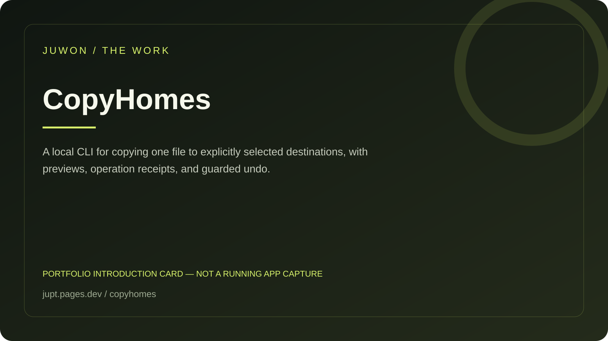

<!-- JUWON-PORTFOLIO-INTRO:START -->
# CopyHomes



*Portfolio introduction card, not a screenshot of a running application.*

*포트폴리오 소개 카드입니다. 실행 화면 캡처가 아닙니다.*

## English

A local CLI for copying one file to explicitly selected destinations, with previews, operation receipts, and guarded undo.

[View JUWON's portfolio](https://jupt.pages.dev/) · [Browse the project collection](https://jupt.pages.dev/projects)

**Scope:** This README presents the repository's documented intent and recorded visual evidence. It does not certify that every feature is complete, deployed, or currently working. Follow the original setup, safety, and license documentation below.

## 한국어

한 파일을 지정한 여러 위치에 복사하고 작업 영수증과 되돌리기를 남기는 CLI.

[JUWON 포트폴리오 보기](https://jupt.pages.dev/) · [전체 프로젝트 보기](https://jupt.pages.dev/projects)

**확인 범위:** 저장소의 문서상 목적과 기록된 화면 근거를 소개합니다. 모든 기능의 완성·배포·현재 정상 작동을 보증하지 않습니다. 설치법·안전 주의사항·라이선스는 아래 기존 문서를 확인하세요.
<!-- JUWON-PORTFOLIO-INTRO:END -->

---

## Original documentation / 기존 문서

# CopyHomes 🏠

## Save one file. Keep it in the homes you choose.

CopyHomes turns the annoying “save this again in three places” ritual into one
visible, reviewable action. Preview first. Copy once. Get a receipt. Undo later.

```text
copyhomes plan notes.md ./backup ./share
copyhomes save notes.md ./backup ./share --receipt ./receipts/notes.json
copyhomes undo ./receipts/notes.json
```

No cloud. No sync daemon. No silent overwrite. No hidden cleanup.

## Why it exists

Sync tools are great when folders should continuously converge. CopyHomes is
for the smaller, more human decision: “this exact file belongs in these exact
homes right now.” The preview shows every target before a byte is written.

## What it does

- `plan` calculates SHA-256, target paths, and an action for every home without
  writing files.
- `save` creates missing files atomically and refuses differing targets unless
  `--replace` is explicit.
- `save` requires a JSON receipt so the operation can be reviewed and undone.
- `undo` removes only files still matching the receipt or restores verified
  replacement backups.
- `--json` makes the result scriptable.
- `--create-dirs` opts into creating missing destination directories.

## Install

Python 3.10+; runtime has zero dependencies.

```text
python -m pip install copyhomes
```

Or install the wheel from the [v0.1.0 release](../../releases/tag/v0.1.0).

## Human flow

```text
# 1. Read-only preview. Nothing changes.
copyhomes plan ./draft.md ./backup ./client-share

# 2. Apply only after preview looks right. Receipt is mandatory.
copyhomes save ./draft.md ./backup ./client-share \
  --receipt ./receipts/draft.json

# 3. Reverse the exact operation if needed.
copyhomes undo ./receipts/draft.json
```

If a target already exists with different bytes, CopyHomes stops and explains
the conflict. Use `--replace` only when replacement is intentional; a receipt
then stores a local recovery copy.

## Exit codes

- `0`: preview or operation completed.
- `1`: expected plan/undo conflict; no unsafe action was taken.
- `2`: invalid input, missing source, malformed receipt, or operating-system
  error.

## Safety and privacy

CopyHomes is local-first and intentionally boring about power: no network,
telemetry, shell commands, process control, or clipboard access. Read
[SECURITY.md](SECURITY.md) before using `--replace`. Receipts contain absolute
paths and SHA-256 hashes; do not publish them if paths are sensitive.

## Research and verification

- [Product research](docs/research.md)
- [Verification record](docs/verification.md)
- [Contributing](CONTRIBUTING.md)

## License

MIT. See [LICENSE](LICENSE).
